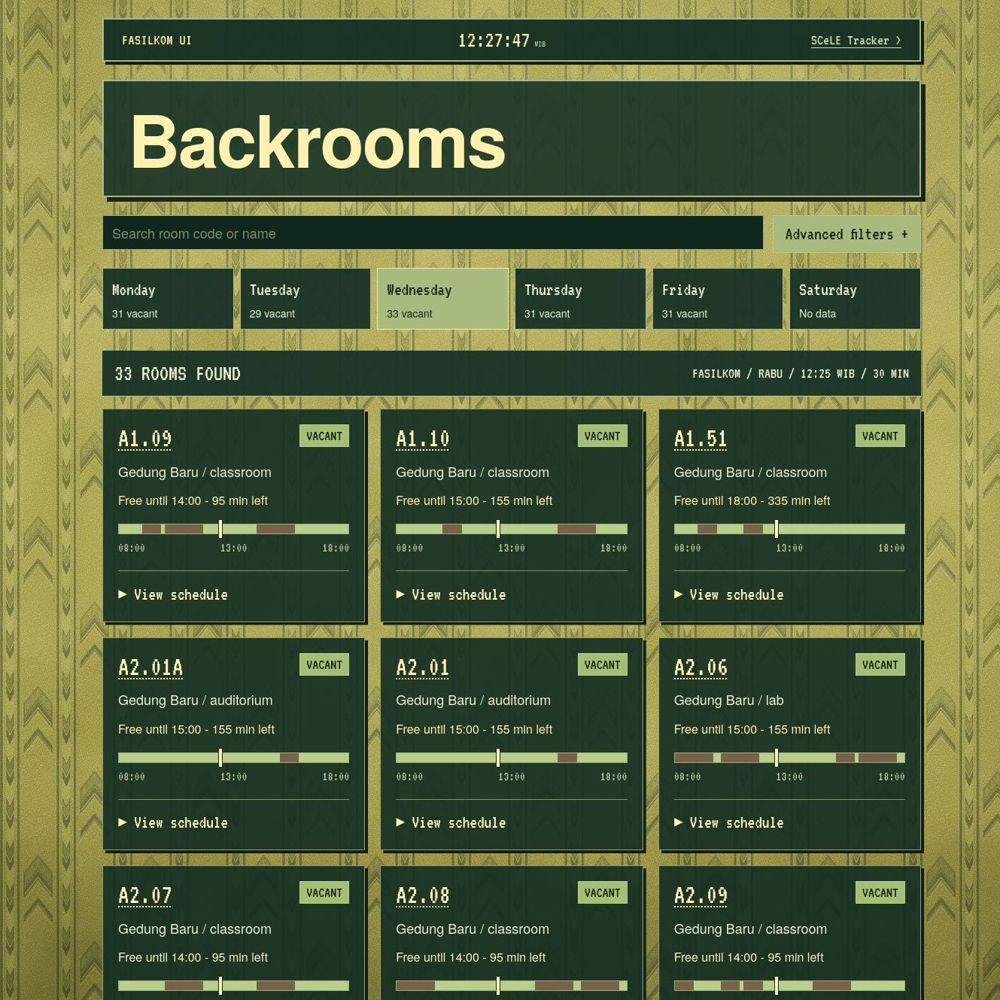

# <div align="center">Backrooms (of UI)</div>

Vacant room discovery for Universitas Indonesia (UI) faculties, powered by live academic class schedules from [SLCM UI](https://slcm.ui.ac.id) and styled after retro [liminal spaces](https://en.wikipedia.org/wiki/Liminal_space).



> Check out live deployment: **https://backrooms.taruna.me**

## Overview

Backrooms aggregates faculty room schedules across UI (all faculities, including Fasilkom, FT, FMIPA, FEB, FH, FPsi, FIB, FISIP, FKM, FK, FKG, FIK, FF, FIA, and Sekolah Vokasi) and searches vacant rooms between 08:00 and 18:00 WIB so students can quickly find an empty classroom or lab for self-study or group work (*kerkom*) without logging in.

## Features

- Queries sub-organization schedules **per faculty** from SLCM, retaining all active courses while allowing room discovery filtered by program level (S1-S3, D2-D3-D4, or all strata).
- Automatically classifies rooms across **Gedung Baru** and **Gedung Lama** exclusively for Fasilkom, and others (Salemba campus, virtual/online rooms).
- Distinguishes rooms between **Vacant** (free for at least the requested minimum duration), **Semivacant** (currently free, but a class starts before the minimum duration finishes), **Occupied**, and **No Data**.
- Each room card renders an 08:00–18:00 timeline bar where you can select specific time.
- Caches schedules per faculty in WAL mode with stale-while-revalidate background refreshes, request deduplication, 5-minute failure backoff, and automatic cache invalidation on server startup.
- Full English (`EN`) and Indonesian (`ID`) localization via `react-i18next`.

## Deployment

Compile the TypeScript client, bundle assets with Vite into `dist/`, compile the server into `dist-server/`, and start the single-port Fastify server:

```bash
pnpm build
pnpm start
```

### Docker

Build and run the multi-stage production container (runs rootless as `1002:1002` with persistent SQLite storage at `/app/data/rooms.sqlite`):

```bash
docker build -t local/backrooms:0.1.0 .
docker run -d --name backrooms \
    -p 3017:3017 \
    --env-file .env \
    -v ./data:/app/data \
    local/backrooms:0.1.0
```

## Development

The project uses the following software and configuration:

- **Node.js**: `>= 24.x` (uses built-in `node:sqlite`)
- **Package Manager**: `pnpm`
- **SLCM Credentials**: A valid UI SSO account is required by the backend to authenticate against `login.ui.ac.id` (Keycloak PKCE) and fetch schedules from `slcm.ui.ac.id`.

### Architecture

- **`shared/rooms.ts`**: faculty registry, room metadata parser (`roomInfo`), interval clipping/merging (`freeSlots`), and vacancy evaluator (`vacancyStatus`).
- **`server/`**: Fastify HTTP server (`app.ts`, `index.ts`), Keycloak PKCE + SLCM schedule scraper (`slcm.ts`), and `node:sqlite` persistent cache (`store.ts`).
- **`src/`**: React 19 + Vite frontend, Tailwind CSS v4 with theme definintions (`index.css`), discovery state provider (`state/RoomState.tsx`), and accessible retro UI components (`components/`).
- **`tests/`**: Vitest suite covering interval merging, Jakarta timezone boundaries, SLCM schedule parsing, multi-strata room occupancy, and SQLite cache lifecycle.

### Dev Server

Run the Fastify API server (port `3017`) and the Vite frontend dev server (port `5177`, proxying `/api` to `127.0.0.1:3017`):

```bash
pnpm dev:api
pnpm dev
```

Verify the API health and faculty schedule endpoints once running:

```bash
curl -s http://127.0.0.1:3017/api/health
# Expected output:
# {"ok":true}

curl -s "http://127.0.0.1:3017/api/rooms/schedule?faculty=fasilkom" | head -c 120
# Expected output:
# {"faculty":"fasilkom","schedule":{"senin":{...
```

### Configuration

Provide credentials via environment variables or an untracked `AUTH_DATA.env` file in the project root:

```env
SLCM_USERNAME=your_ui_sso_username
SLCM_PASSWORD=your_ui_sso_password
```

Optional runtime environment variables:

| Variable | Default | Description |
| :--- | :--- | :--- |
| `PORT` | `3017` | HTTP server listening port |
| `HOST` | `0.0.0.0` | HTTP server bind address |
| `DB_PATH` | `data/rooms.sqlite` | Path to the SQLite cache file |
| `ADMIN_CONFIG_PATH` | `data/admins.json` | Path to administrator JSON configuration |
| `AUTH_USER_HEADER` | `Remote-User` | Reverse proxy header forwarding authenticated user |

### Admin Configuration (`data/admins.json`)

To enable the admin cache force-refresh feature, configure authorized usernames or groups in `data/admins.json` (or via `ADMINS_JSON` environment variable):

```json
{
    "admins": [
        "taruna"
    ],
    "admin_groups": [
        "admins"
    ]
}
```

Authentication is delegated to external reverse proxy / LDAP forward-auth (Authelia first-party supported via `Remote-User` and `Remote-Groups`). Backrooms performs zero local password management.

### Testing

Run the standard unit tests, isolated integration tests, or static analysis:

```bash
# Fast unit tests (in-memory, no external dependencies)
pnpm test

# Integration tests (verifies live Authelia forward-auth flow)
pnpm test:integration

# All tests
pnpm test:all

# Type-checking and linting
pnpm check
```

#### Running Authelia Locally for Integration Tests

For developers running integration tests without access to an external Authelia deployment, a portable file-based Authelia test fixture is provided in `dev/authelia/`:

```bash
docker compose -f dev/authelia/compose.yml up -d
pnpm test:integration
```

Test credentials configured in `dev/authelia/users_database.yml`:
- Admin account: `admin_dev` (password: `***`, groups: `admins`, `devs`)
- Guest account: `guest_dev` (password: `***`, groups: `users`)

## License & Attribution

- Backrooms project is released under the [MIT License](LICENSE), Copyright (c) 2026 [Taruna Prasetya](https://taruna.me).
- Schedule data are sourced from [SLCM UI](https://slcm.ui.ac.id). Backrooms is an independent student project and is not an official Universitas Indonesia service.
- *"Stylized Backrooms 'Chevron' Wallpaper"* by For underscore dev ([CC0 1.0](https://commons.wikimedia.org/wiki/File:Stylized_Backrooms_%27Chevron%27_Wallpaper.png)); **VT323** font by Peter Hull ([SIL Open Font License](https://openfontlicense.org)).
